# Rancangan Database Dashboard Siswa Sekolah Dasar

## 1. Informasi Proyek

| Item | Keterangan |
|---|---|
| Nama proyek | Dashboard Siswa Sekolah Dasar |
| Framework | Laravel 11 |
| Bahasa | PHP 8.2 |
| Database pengembangan | SQLite |
| Database target | MySQL atau PostgreSQL |
| UI | Blade + Tailwind CSS (Laravel Breeze) |
| Developer | 1 orang |
| Role | Admin, Kepala Sekolah, Wali Kelas, Guru Mapel, Orang Tua (opsional) |

### Fitur utama

- Login dan otorisasi berbasis role.
- Master data siswa, kelas, tahun ajaran, semester, mata pelajaran, dan guru.
- Input nilai tugas, UTS, UAS, dan rekap nilai akhir.
- Absensi harian siswa.
- Ranking kelas otomatis.
- Rekomendasi ranking beasiswa berdasarkan kriteria dan bobot.
- Dashboard dan grafik ringkasan akademik.
- Ekspor laporan PDF dan Excel.
- Audit perubahan nilai.
- Pembatasan akses terhadap data siswa berdasarkan role dan relasi.

## 2. Prinsip Desain Database

1. **Identitas dipisahkan dari histori akademik.** Data identitas siswa disimpan satu kali di `students`, sedangkan penempatan kelas disimpan per tahun ajaran di `class_enrollments`.
2. **Data akademik terikat periode.** Nilai terikat semester, dan semester terikat tahun ajaran. Data tahun sebelumnya tidak ditimpa ketika tahun ajaran berganti.
3. **Akun dipisahkan dari profil.** `users` menangani autentikasi; `teachers` dan `parents` menyimpan profil serta relasi domain.
4. **Akses diperiksa di backend.** Relasi akun dengan kelas, mata pelajaran, dan anak digunakan untuk otorisasi setiap request.
5. **Ranking disimpan sebagai snapshot.** Hasil ranking dan konfigurasi bobot disimpan per proses agar hasil yang sudah dipublikasikan dapat ditelusuri.
6. **Perubahan nilai diaudit.** Nilai lama, nilai baru, pengguna pengubah, dan waktu perubahan disimpan di log.
7. **Portabilitas database.** Gunakan tipe dan query Eloquent yang umum; uji kembali constraint, tanggal, boolean, agregasi, dan transaksi saat migrasi database.

## 3. ERD (Mermaid)

Diagram berikut mencakup tabel akun, profil, periode akademik, nilai, absensi, audit, bobot beasiswa, hasil ranking kelas, dan hasil ranking beasiswa.

```mermaid
erDiagram
    USERS {
        bigint id PK
        string name
        string email UK
        string password
        string role
        boolean is_active
    }

    STUDENTS {
        bigint id PK
        string nis UK
        string nisn UK
        string full_name
        date birth_date
        string gender
        boolean is_active
    }

    TEACHERS {
        bigint id PK
        bigint user_id FK
        string employee_number UK
        string full_name
    }

    PARENTS {
        bigint id PK
        bigint user_id FK
        string full_name
        string phone
    }

    STUDENT_PARENTS {
        bigint student_id PK,FK
        bigint parent_id PK,FK
        string relationship
    }

    CLASSES {
        bigint id PK
        string name
        string grade_level
    }

    SCHOOL_YEARS {
        bigint id PK
        string name UK
        date start_date
        date end_date
        boolean is_active
    }

    SEMESTERS {
        bigint id PK
        bigint school_year_id FK
        string name
        date start_date
        date end_date
    }

    SUBJECTS {
        bigint id PK
        string code UK
        string name
        boolean is_active
    }

    CLASS_ENROLLMENTS {
        bigint id PK
        bigint student_id FK
        bigint class_id FK
        bigint school_year_id FK
        bigint homeroom_teacher_id FK
        string status
    }

    CLASS_SUBJECTS {
        bigint id PK
        bigint class_id FK
        bigint subject_id FK
        bigint school_year_id FK
        bigint teacher_id FK
    }

    GRADES {
        bigint id PK
        bigint enrollment_id FK
        bigint class_subject_id FK
        bigint semester_id FK
        decimal assignment_score
        decimal uts_score
        decimal uas_score
        decimal final_score
        bigint updated_by FK
    }

    GRADE_CHANGE_LOGS {
        bigint id PK
        bigint grade_id FK
        bigint changed_by FK
        string action
        text old_values
        text new_values
        datetime changed_at
    }

    ATTENDANCES {
        bigint id PK
        bigint enrollment_id FK
        date attendance_date
        string status
        bigint recorded_by FK
    }

    SCHOLARSHIP_CRITERIA {
        bigint id PK
        string code UK
        string name
        string attribute_type
        string direction
        boolean is_active
    }

    SCHOLARSHIP_WEIGHT_SETS {
        bigint id PK
        bigint school_year_id FK
        bigint semester_id FK
        string version_name
        boolean is_locked
        bigint created_by FK
    }

    SCHOLARSHIP_WEIGHTS {
        bigint id PK,FK
        bigint weight_set_id PK,FK
        decimal weight
    }

    SCHOLARSHIP_RANKING_RUNS {
        bigint id PK
        bigint school_year_id FK
        bigint semester_id FK
        bigint weight_set_id FK
        datetime calculated_at
        string status
        bigint calculated_by FK
    }

    SCHOLARSHIP_RANKING_RESULTS {
        bigint id PK
        bigint ranking_run_id FK
        bigint enrollment_id FK
        int rank
        decimal preference_score
        text criteria_snapshot
    }

    CLASS_RANKING_RUNS {
        bigint id PK
        bigint school_year_id FK
        bigint semester_id FK
        bigint class_id FK
        datetime calculated_at
        string status
    }

    CLASS_RANKING_RESULTS {
        bigint id PK
        bigint ranking_run_id FK
        bigint enrollment_id FK
        int rank
        decimal average_score
    }

    USERS ||--o| TEACHERS : has_profile
    USERS ||--o| PARENTS : has_profile
    USERS ||--o{ GRADE_CHANGE_LOGS : changes
    USERS ||--o{ GRADES : updates
    USERS ||--o{ ATTENDANCES : records
    USERS ||--o{ SCHOLARSHIP_WEIGHT_SETS : creates
    USERS ||--o{ SCHOLARSHIP_RANKING_RUNS : calculates

    STUDENTS ||--o{ STUDENT_PARENTS : linked_to
    PARENTS ||--o{ STUDENT_PARENTS : linked_to

    STUDENTS ||--o{ CLASS_ENROLLMENTS : enrolls
    CLASSES ||--o{ CLASS_ENROLLMENTS : contains
    SCHOOL_YEARS ||--o{ CLASS_ENROLLMENTS : records
    TEACHERS o|--o{ CLASS_ENROLLMENTS : homeroom

    SCHOOL_YEARS ||--o{ SEMESTERS : contains
    CLASSES ||--o{ CLASS_SUBJECTS : offers
    SUBJECTS ||--o{ CLASS_SUBJECTS : assigned
    SCHOOL_YEARS ||--o{ CLASS_SUBJECTS : applies
    TEACHERS ||--o{ CLASS_SUBJECTS : teaches

    CLASS_ENROLLMENTS ||--o{ GRADES : receives
    CLASS_SUBJECTS ||--o{ GRADES : assesses
    SEMESTERS ||--o{ GRADES : records
    GRADES ||--o{ GRADE_CHANGE_LOGS : audited
    CLASS_ENROLLMENTS ||--o{ ATTENDANCES : has

    SCHOOL_YEARS ||--o{ SCHOLARSHIP_WEIGHT_SETS : defines
    SEMESTERS ||--o{ SCHOLARSHIP_WEIGHT_SETS : applies
    SCHOLARSHIP_WEIGHT_SETS ||--o{ SCHOLARSHIP_WEIGHTS : contains
    SCHOLARSHIP_CRITERIA ||--o{ SCHOLARSHIP_WEIGHTS : weighted

    SCHOLARSHIP_WEIGHT_SETS ||--o{ SCHOLARSHIP_RANKING_RUNS : used_in
    SCHOOL_YEARS ||--o{ SCHOLARSHIP_RANKING_RUNS : calculates
    SEMESTERS ||--o{ SCHOLARSHIP_RANKING_RUNS : calculates
    SCHOLARSHIP_RANKING_RUNS ||--o{ SCHOLARSHIP_RANKING_RESULTS : produces
    CLASS_ENROLLMENTS ||--o{ SCHOLARSHIP_RANKING_RESULTS : ranked

    SCHOOL_YEARS ||--o{ CLASS_RANKING_RUNS : calculates
    SEMESTERS ||--o{ CLASS_RANKING_RUNS : calculates
    CLASSES ||--o{ CLASS_RANKING_RUNS : calculates
    CLASS_RANKING_RUNS ||--o{ CLASS_RANKING_RESULTS : produces
    CLASS_ENROLLMENTS ||--o{ CLASS_RANKING_RESULTS : ranked
```

**Catatan ERD:**
- `PK` = Primary Key, `FK` = Foreign Key, `UK` = Unique Key.
- Kolom dengan penanda `PK,FK` merupakan bagian primary key sekaligus foreign key.
- Mermaid ERD menunjukkan relasi inti. Constraint unik gabungan, nullable, dan validasi lintas tabel dijabarkan pada data dictionary.
- Tabel `scholarship_criteria` sengaja dipisahkan dari `scholarship_weights` agar kriteria dan bobot per periode dapat dikelola secara independen.
- Tabel `*_runs` menyimpan metadata proses perhitungan; tabel `*_results` menyimpan hasil per siswa.

## 4. Konvensi Tipe Data dan Constraint

Tipe data pada dictionary menggunakan nama SQL konseptual. Dalam migration Laravel, gunakan `$table->id()`, `$table->foreignId()`, `$table->string()`, `$table->decimal()`, `$table->date()`, `$table->dateTime()`, `$table->boolean()`, dan `$table->text()` sesuai kebutuhan.

- `PK`: primary key.
- `FK`: foreign key.
- `UQ`: unique constraint.
- `NN`: `NOT NULL`.
- `?`: nullable.
- `UK`: unique key.
- `DECIMAL(5,2)`: cocok untuk nilai 0–100 dengan dua angka desimal.
- Tanggal dan waktu disimpan dalam tipe `date`/`datetime`, bukan string bebas.
- ID dan nomor identitas siswa bukan untuk operasi aritmetika; nomor identitas disimpan sebagai string.

## 5. Data Dictionary

### 5.1 `users` — akun login

| Kolom | Tipe data | Constraint | Keterangan |
|---|---|---|---|
| `id` | BIGINT | PK | ID akun |
| `name` | VARCHAR(150) | NN | Nama pengguna |
| `email` | VARCHAR(255) | NN, UQ | Email login |
| `password` | VARCHAR(255) | NN | Password hash Laravel |
| `role` | VARCHAR(30) | NN | `admin`, `kepala_sekolah`, `wali_kelas`, `guru_mapel`, `orang_tua` |
| `is_active` | BOOLEAN | NN, default true | Status akun |
| `email_verified_at` | DATETIME | ? | Waktu verifikasi email |
| `remember_token` | VARCHAR(100) | ? | Token autentikasi |
| `created_at` | DATETIME | ? | Waktu pembuatan |
| `updated_at` | DATETIME | ? | Waktu perubahan |

**Alasan:** satu kolom role memadai untuk kebutuhan awal. Jika seorang pengguna kelak dapat mempunyai beberapa role, gunakan tabel `roles` dan `user_roles`.

### 5.2 `students` — identitas siswa

| Kolom | Tipe data | Constraint | Keterangan |
|---|---|---|---|
| `id` | BIGINT | PK | ID internal siswa |
| `nis` | VARCHAR(30) | NN, UQ | Nomor induk sekolah |
| `nisn` | VARCHAR(20) | ?, UQ | NISN jika tersedia |
| `full_name` | VARCHAR(150) | NN | Nama lengkap |
| `birth_date` | DATE | ? | Tanggal lahir |
| `gender` | VARCHAR(10) | ? | Jenis kelamin |
| `address` | TEXT | ? | Alamat |
| `is_active` | BOOLEAN | NN, default true | Status siswa |
| `created_at` | DATETIME | ? | Waktu pembuatan |
| `updated_at` | DATETIME | ? | Waktu perubahan |

NIS dan NISN disimpan sebagai string. Jangan menghapus data siswa hanya karena siswa sudah lulus; tandai statusnya dan pertahankan histori akademik.

### 5.3 `teachers` — profil guru

| Kolom | Tipe data | Constraint | Keterangan |
|---|---|---|---|
| `id` | BIGINT | PK | ID guru |
| `user_id` | BIGINT | FK, UQ, ? | Akun login guru |
| `employee_number` | VARCHAR(30) | ?, UQ | NIP/NUPTK/nomor pegawai |
| `full_name` | VARCHAR(150) | NN | Nama guru |
| `created_at` | DATETIME | ? | Waktu pembuatan |
| `updated_at` | DATETIME | ? | Waktu perubahan |

`user_id` nullable agar profil guru dapat dimasukkan sebelum akun dibuat. Jika aplikasi mewajibkan semua guru login, ubah menjadi `NOT NULL`.

### 5.4 `parents` — profil orang tua/wali

| Kolom | Tipe data | Constraint | Keterangan |
|---|---|---|---|
| `id` | BIGINT | PK | ID orang tua |
| `user_id` | BIGINT | FK, UQ, ? | Akun login orang tua |
| `full_name` | VARCHAR(150) | NN | Nama orang tua |
| `phone` | VARCHAR(30) | ? | Nomor kontak |
| `created_at` | DATETIME | ? | Waktu pembuatan |
| `updated_at` | DATETIME | ? | Waktu perubahan |

### 5.5 `student_parents` — relasi siswa dan orang tua

| Kolom | Tipe data | Constraint | Keterangan |
|---|---|---|---|
| `student_id` | BIGINT | PK, FK | Referensi `students.id` |
| `parent_id` | BIGINT | PK, FK | Referensi `parents.id` |
| `relationship` | VARCHAR(20) | NN | Ayah, ibu, atau wali |
| `created_at` | DATETIME | ? | Waktu relasi dibuat |

Primary key gabungan `(student_id, parent_id)` mencegah relasi yang sama tercatat dua kali. Index tambahan `(parent_id, student_id)` membantu mencari semua anak milik orang tua.

### 5.6 `classes` — master kelas

| Kolom | Tipe data | Constraint | Keterangan |
|---|---|---|---|
| `id` | BIGINT | PK | ID kelas |
| `name` | VARCHAR(50) | NN | Nama kelas, misalnya 1A |
| `grade_level` | SMALLINT | NN | Tingkat 1–6 |
| `created_at` | DATETIME | ? | Waktu pembuatan |
| `updated_at` | DATETIME | ? | Waktu perubahan |

Jika nama kelas berlaku unik untuk seluruh sekolah, tambahkan `UQ(name)`. Jika identitas rombongan kelas perlu dipertahankan lintas tahun, gunakan ID kelas yang stabil dan simpan keanggotaannya di `class_enrollments`.

### 5.7 `school_years` — tahun ajaran

| Kolom | Tipe data | Constraint | Keterangan |
|---|---|---|---|
| `id` | BIGINT | PK | ID tahun ajaran |
| `name` | VARCHAR(20) | NN, UQ | Contoh `2026/2027` |
| `start_date` | DATE | NN | Tanggal mulai |
| `end_date` | DATE | NN | Tanggal selesai |
| `is_active` | BOOLEAN | NN, default false | Penanda tahun ajaran aktif |
| `created_at` | DATETIME | ? | Waktu pembuatan |
| `updated_at` | DATETIME | ? | Waktu perubahan |

Validasi `end_date > start_date`. Pastikan hanya ada satu tahun ajaran aktif melalui validasi aplikasi/transaksi atau mekanisme database yang sesuai.

### 5.8 `semesters` — semester

| Kolom | Tipe data | Constraint | Keterangan |
|---|---|---|---|
| `id` | BIGINT | PK | ID semester |
| `school_year_id` | BIGINT | FK, NN | Tahun ajaran |
| `name` | VARCHAR(20) | NN | Ganjil atau Genap |
| `start_date` | DATE | NN | Tanggal mulai |
| `end_date` | DATE | NN | Tanggal selesai |
| `created_at` | DATETIME | ? | Waktu pembuatan |
| `updated_at` | DATETIME | ? | Waktu perubahan |

Constraint: `UQ(school_year_id, name)`. Semester Ganjil pada tahun ajaran berbeda merupakan periode berbeda.

### 5.9 `subjects` — mata pelajaran

| Kolom | Tipe data | Constraint | Keterangan |
|---|---|---|---|
| `id` | BIGINT | PK | ID mata pelajaran |
| `code` | VARCHAR(30) | NN, UQ | Kode mata pelajaran |
| `name` | VARCHAR(100) | NN | Nama mata pelajaran |
| `is_active` | BOOLEAN | NN, default true | Status aktif |
| `created_at` | DATETIME | ? | Waktu pembuatan |
| `updated_at` | DATETIME | ? | Waktu perubahan |

### 5.10 `class_enrollments` — penempatan siswa per tahun ajaran

| Kolom | Tipe data | Constraint | Keterangan |
|---|---|---|---|
| `id` | BIGINT | PK | ID penempatan |
| `student_id` | BIGINT | FK, NN | Siswa |
| `class_id` | BIGINT | FK, NN | Kelas |
| `school_year_id` | BIGINT | FK, NN | Tahun ajaran |
| `homeroom_teacher_id` | BIGINT | FK ke `teachers.id`, ? | Wali kelas |
| `status` | VARCHAR(20) | NN | `aktif`, `pindah`, `selesai` |
| `created_at` | DATETIME | ? | Waktu pembuatan |
| `updated_at` | DATETIME | ? | Waktu perubahan |

Constraint utama: `UQ(student_id, school_year_id)` jika siswa hanya boleh memiliki satu kelas dalam satu tahun ajaran. Saat siswa naik kelas, buat penempatan baru; jangan menimpa penempatan lama.

### 5.11 `class_subjects` — penugasan mapel dan guru

| Kolom | Tipe data | Constraint | Keterangan |
|---|---|---|---|
| `id` | BIGINT | PK | ID penugasan |
| `class_id` | BIGINT | FK, NN | Kelas |
| `subject_id` | BIGINT | FK, NN | Mata pelajaran |
| `school_year_id` | BIGINT | FK, NN | Tahun ajaran |
| `teacher_id` | BIGINT | FK ke `teachers.id`, NN | Guru pengampu |
| `created_at` | DATETIME | ? | Waktu pembuatan |
| `updated_at` | DATETIME | ? | Waktu perubahan |

Constraint yang disarankan: `UQ(class_id, subject_id, school_year_id)` jika satu mapel hanya memiliki satu guru per kelas per tahun ajaran. Jika lebih dari satu guru dapat mengampu mapel yang sama, sesuaikan constraint atau desain penugasan.

### 5.12 `grades` — nilai siswa

| Kolom | Tipe data | Constraint | Keterangan |
|---|---|---|---|
| `id` | BIGINT | PK | ID data nilai |
| `enrollment_id` | BIGINT | FK, NN | Penempatan siswa |
| `class_subject_id` | BIGINT | FK, NN | Penugasan mapel |
| `semester_id` | BIGINT | FK, NN | Semester |
| `assignment_score` | DECIMAL(5,2) | NN | Nilai tugas |
| `uts_score` | DECIMAL(5,2) | NN | Nilai UTS |
| `uas_score` | DECIMAL(5,2) | NN | Nilai UAS |
| `final_score` | DECIMAL(5,2) | NN | Nilai akhir |
| `updated_by` | BIGINT | FK ke `users.id`, ? | Pengguna terakhir yang mengubah |
| `created_at` | DATETIME | ? | Waktu pembuatan |
| `updated_at` | DATETIME | ? | Waktu perubahan |

Constraint: `UQ(enrollment_id, class_subject_id, semester_id)`. Validasi nilai 0–100 di aplikasi dan, jika sesuai, melalui constraint database.

Contoh formula nilai akhir (bukan ketentuan baku):

`Nilai Akhir = (30% × Tugas) + (30% × UTS) + (40% × UAS)`

Formula final perlu disetujui sekolah. Pastikan semester yang dipilih berada dalam tahun ajaran penempatan siswa dan penugasan mapel terkait; validasi lintas tabel ini perlu dilakukan di aplikasi atau melalui desain constraint tambahan.

### 5.13 `grade_change_logs` — log perubahan nilai

| Kolom | Tipe data | Constraint | Keterangan |
|---|---|---|---|
| `id` | BIGINT | PK | ID log |
| `grade_id` | BIGINT | FK, NN | Data nilai terkait |
| `changed_by` | BIGINT | FK ke `users.id`, NN | Pengguna pengubah |
| `action` | VARCHAR(20) | NN | `created`, `updated`, `deleted` |
| `old_values` | TEXT | ? | Snapshot nilai sebelum perubahan |
| `new_values` | TEXT | ? | Snapshot nilai setelah perubahan |
| `changed_at` | DATETIME | NN | Waktu perubahan |
| `reason` | TEXT | ? | Alasan perubahan, jika diwajibkan |

`old_values` dan `new_values` dapat berisi JSON yang divalidasi di aplikasi. Contoh:

- Sebelum: `{"uts_score":75,"uas_score":80}`
- Sesudah: `{"uts_score":85,"uas_score":80}`

Tulis log dalam transaksi yang sama dengan update nilai. Batasi update/delete terhadap log. Pertimbangkan soft delete pada data nilai atau kebijakan retensi yang sesuai agar histori audit tidak hilang.

### 5.14 `attendances` — absensi harian

| Kolom | Tipe data | Constraint | Keterangan |
|---|---|---|---|
| `id` | BIGINT | PK | ID absensi |
| `enrollment_id` | BIGINT | FK, NN | Penempatan siswa |
| `attendance_date` | DATE | NN | Tanggal absensi |
| `status` | VARCHAR(10) | NN | `sakit`, `izin`, `alpa` |
| `recorded_by` | BIGINT | FK ke `users.id`, NN | Pengguna pencatat |
| `notes` | TEXT | ? | Keterangan |
| `created_at` | DATETIME | ? | Waktu pembuatan |
| `updated_at` | DATETIME | ? | Waktu perubahan |

Constraint: `UQ(enrollment_id, attendance_date)` jika hanya satu status per siswa per hari. Jika diperlukan, tambahkan status `hadir` agar rekap kehadiran eksplisit. Kebijakan ketidakhadiran tanpa catatan harus ditetapkan agar persentase kehadiran akurat.

### 5.15 `scholarship_criteria` — master kriteria beasiswa

| Kolom | Tipe data | Constraint | Keterangan |
|---|---|---|---|
| `id` | BIGINT | PK | ID kriteria |
| `code` | VARCHAR(30) | NN, UQ | Contoh `C1`, `C2` |
| `name` | VARCHAR(100) | NN | Nama kriteria |
| `attribute_type` | VARCHAR(20) | NN | `numeric` atau `ordinal` |
| `direction` | VARCHAR(10) | NN | `benefit` atau `cost` |
| `description` | TEXT | ? | Deskripsi kriteria |
| `is_active` | BOOLEAN | NN, default true | Status kriteria |
| `created_at` | DATETIME | ? | Waktu pembuatan |
| `updated_at` | DATETIME | ? | Waktu perubahan |

Contoh: pendapatan orang tua umumnya bertipe `cost`, nilai akademik bertipe `benefit`. Kategori seperti pekerjaan orang tua harus memiliki skala yang didefinisikan secara eksplisit sebelum diproses oleh TOPSIS.

### 5.16 `scholarship_weight_sets` — versi bobot beasiswa

| Kolom | Tipe data | Constraint | Keterangan |
|---|---|---|---|
| `id` | BIGINT | PK | ID versi bobot |
| `school_year_id` | BIGINT | FK, NN | Tahun ajaran |
| `semester_id` | BIGINT | FK, NN | Semester |
| `version_name` | VARCHAR(50) | NN | Contoh `Bobot v1` |
| `is_locked` | BOOLEAN | NN, default false | Kunci perubahan setelah dipakai |
| `created_by` | BIGINT | FK ke `users.id`, NN | Pembuat |
| `created_at` | DATETIME | ? | Waktu pembuatan |
| `updated_at` | DATETIME | ? | Waktu perubahan |

Buat versi baru jika kebijakan bobot berubah setelah dipakai untuk perhitungan atau publikasi.

### 5.17 `scholarship_weights` — bobot per kriteria

| Kolom | Tipe data | Constraint | Keterangan |
|---|---|---|---|
| `id` | BIGINT | PK | ID bobot |
| `weight_set_id` | BIGINT | FK, NN | Versi bobot |
| `criterion_id` | BIGINT | FK, NN | Kriteria |
| `weight` | DECIMAL(8,6) | NN | Bobot kriteria |
| `created_at` | DATETIME | ? | Waktu pembuatan |
| `updated_at` | DATETIME | ? | Waktu perubahan |

Constraint: `UQ(weight_set_id, criterion_id)`. Validasi bobot positif dan jumlah bobot sama dengan 1 atau 100%, sesuai konvensi yang dipilih. Terapkan validasi pada saat menyimpan versi bobot.

### 5.18 `scholarship_ranking_runs` — proses ranking beasiswa

| Kolom | Tipe data | Constraint | Keterangan |
|---|---|---|---|
| `id` | BIGINT | PK | ID proses |
| `school_year_id` | BIGINT | FK, NN | Tahun ajaran |
| `semester_id` | BIGINT | FK, NN | Semester |
| `weight_set_id` | BIGINT | FK, NN | Versi bobot |
| `calculated_at` | DATETIME | NN | Waktu perhitungan |
| `status` | VARCHAR(20) | NN | `draft`, `published`, `superseded` |
| `calculated_by` | BIGINT | FK ke `users.id`, NN | Pengguna yang menjalankan |
| `created_at` | DATETIME | ? | Waktu pembuatan |

Satu proses ranking mengacu pada satu periode dan satu versi bobot. Validasi bahwa periode bobot sama dengan periode proses dilakukan di aplikasi.

### 5.19 `scholarship_ranking_results` — hasil ranking beasiswa

| Kolom | Tipe data | Constraint | Keterangan |
|---|---|---|---|
| `id` | BIGINT | PK | ID hasil |
| `ranking_run_id` | BIGINT | FK, NN | Proses ranking |
| `enrollment_id` | BIGINT | FK, NN | Penempatan siswa |
| `rank` | INTEGER | NN | Urutan rekomendasi |
| `preference_score` | DECIMAL(12,10) | NN | Nilai preferensi TOPSIS |
| `criteria_snapshot` | TEXT | NN | Snapshot data kriteria yang dipakai |
| `created_at` | DATETIME | ? | Waktu pembuatan |

Constraint: `UQ(ranking_run_id, enrollment_id)` dan, jika peringkat wajib unik, `UQ(ranking_run_id, rank)`. Hasil adalah rekomendasi, bukan keputusan final penerima bantuan.

### 5.20 `class_ranking_runs` — proses ranking kelas

| Kolom | Tipe data | Constraint | Keterangan |
|---|---|---|---|
| `id` | BIGINT | PK | ID proses |
| `school_year_id` | BIGINT | FK, NN | Tahun ajaran |
| `semester_id` | BIGINT | FK, NN | Semester |
| `class_id` | BIGINT | FK, NN | Kelas |
| `calculated_at` | DATETIME | NN | Waktu perhitungan |
| `status` | VARCHAR(20) | NN | `draft`, `published`, `superseded` |
| `created_at` | DATETIME | ? | Waktu pembuatan |

Setiap kali ranking dihitung ulang, buat proses baru. Jangan menimpa proses ranking yang telah dipublikasikan.

### 5.21 `class_ranking_results` — hasil ranking kelas

| Kolom | Tipe data | Constraint | Keterangan |
|---|---|---|---|
| `id` | BIGINT | PK | ID hasil |
| `ranking_run_id` | BIGINT | FK, NN | Proses ranking kelas |
| `enrollment_id` | BIGINT | FK, NN | Penempatan siswa |
| `rank` | INTEGER | NN | Peringkat |
| `average_score` | DECIMAL(5,2) | NN | Rata-rata nilai |
| `created_at` | DATETIME | ? | Waktu pembuatan |

Constraint: `UQ(ranking_run_id, enrollment_id)` dan, jika peringkat wajib unik, `UQ(ranking_run_id, rank)`. Definisikan apakah rata-rata dihitung dari seluruh mata pelajaran atau hanya mata pelajaran tertentu.

## 6. Index yang Disarankan

Unique constraint biasanya sudah menghasilkan index pada database. Jangan membuat index tambahan yang identik.

| Tabel | Index / constraint | Tujuan |
|---|---|---|
| `users` | `UNIQUE(email)` | Login berdasarkan email |
| `students` | `UNIQUE(nis)`, `UNIQUE(nisn)` | Identifikasi siswa |
| `teachers` | `UNIQUE(user_id)`, `UNIQUE(employee_number)` | Relasi akun dan pencarian guru |
| `parents` | `UNIQUE(user_id)` | Relasi akun orang tua |
| `student_parents` | PK `(student_id, parent_id)`; index `(parent_id, student_id)` | Pencarian relasi dua arah |
| `semesters` | `UNIQUE(school_year_id, name)` | Semester per tahun ajaran |
| `class_enrollments` | `UNIQUE(student_id, school_year_id)` | Satu kelas per siswa per tahun |
| `class_enrollments` | `(class_id, school_year_id, status)` | Daftar siswa per kelas |
| `class_enrollments` | `(homeroom_teacher_id, school_year_id)` | Kelas wali |
| `class_subjects` | `UNIQUE(class_id, subject_id, school_year_id)` | Hindari penugasan ganda |
| `class_subjects` | `(teacher_id, school_year_id)` | Penugasan guru |
| `grades` | `UNIQUE(enrollment_id, class_subject_id, semester_id)` | Satu nilai per mapel dan semester |
| `grades` | `(semester_id, class_subject_id)` | Rekap nilai per mapel |
| `grade_change_logs` | `(grade_id, changed_at)` | Riwayat perubahan nilai |
| `grade_change_logs` | `(changed_by, changed_at)` | Audit aktivitas pengguna |
| `attendances` | `UNIQUE(enrollment_id, attendance_date)` | Satu status absensi per hari |
| `attendances` | `(attendance_date, status)` | Rekap absensi |
| `scholarship_weights` | `UNIQUE(weight_set_id, criterion_id)` | Satu bobot per kriteria |
| `scholarship_weight_sets` | `(school_year_id, semester_id)` | Pencarian versi bobot periode |
| `scholarship_ranking_runs` | `(school_year_id, semester_id, status)` | Ranking per periode |
| `scholarship_ranking_results` | `UNIQUE(ranking_run_id, enrollment_id)` | Hindari hasil siswa ganda |
| `scholarship_ranking_results` | `(ranking_run_id, rank)` | Pengurutan ranking |
| `class_ranking_runs` | `(class_id, school_year_id, semester_id)` | Proses ranking kelas |
| `class_ranking_results` | `UNIQUE(ranking_run_id, enrollment_id)` | Hindari hasil siswa ganda |
| `class_ranking_results` | `(ranking_run_id, rank)` | Pengurutan ranking |

Jika `nisn` opsional, uji perilaku unique nullable pada database target. SQLite mengizinkan beberapa nilai `NULL` dalam unique index; tetap lakukan pengujian migrasi.

## 7. Matriks Hak Akses

| Role | Akses utama | Batasan |
|---|---|---|
| Admin | Master data, akun, periode, laporan | Perubahan penting tetap diaudit |
| Kepala Sekolah | Dashboard, rekap, ranking, laporan | Read-only pada nilai/absensi kecuali diberi kewenangan |
| Wali Kelas | Nilai, absensi, rekap siswa | Hanya kelas yang ditugaskan pada periode terkait |
| Guru Mapel | Input dan edit nilai | Hanya mapel dan kelas dalam penugasan miliknya |
| Orang Tua | Rapor dan absensi anak | Hanya siswa yang terhubung melalui `student_parents` |

### Aturan keamanan wajib

- Terapkan Laravel Policies/Gates atau mekanisme otorisasi server-side yang setara.
- Jangan menganggap `student_id`, `class_id`, atau `teacher_id` dari request sebagai bukti hak akses.
- Validasi penugasan guru melalui `class_subjects` dan periode akademik terkait.
- Validasi akses orang tua melalui `student_parents` pada setiap request yang membaca data anak.
- Sembunyikan tombol berdasarkan role untuk UX, tetapi jangan mengandalkannya sebagai kontrol keamanan.
- Catat perubahan nilai dalam transaksi yang sama dengan perubahan datanya.
- Batasi akses edit/hapus pada `grade_change_logs`; jangan sediakan fitur edit log biasa.
- Gunakan validasi server-side, CSRF protection, password hashing, dan HTTPS pada deployment.
- Terapkan prinsip least privilege untuk ekspor laporan karena file ekspor dapat memuat data pribadi anak.

## 8. Aturan Histori dan Konsistensi

### 8.1 Tahun ajaran dan semester

- `school_years` menyimpan periode tahunan.
- `semesters` menyimpan semester yang dimiliki satu tahun ajaran.
- `class_enrollments` menyimpan kelas siswa untuk tiap tahun ajaran.
- Jangan mengubah enrollment lama ketika siswa naik kelas; buat enrollment baru.

### 8.2 Nilai

- Setiap record nilai terikat ke enrollment, penugasan mapel, dan semester.
- Validasi bahwa tahun ajaran semester sama dengan tahun ajaran enrollment dan penugasan mapel.
- Formula nilai akhir harus ditetapkan sekolah dan diterapkan secara konsisten.
- Jika nilai diperbaiki setelah rapor/ranking terbit, simpan audit log dan hitung snapshot baru bila diperlukan.

### 8.3 Ranking

- `*_runs` menyimpan metadata proses perhitungan.
- `*_results` menyimpan hasil per siswa pada proses tersebut.
- Perubahan nilai atau bobot tidak boleh diam-diam mengubah hasil ranking yang telah dipublikasikan.
- Tandai proses lama sebagai `superseded` jika sudah digantikan oleh hasil baru.
- Untuk TOPSIS, simpan snapshot kriteria yang digunakan agar rekomendasi bisa ditelusuri.

### 8.4 Penghapusan data

Hindari hard delete untuk siswa, enrollment, nilai, dan histori yang sudah digunakan dalam laporan. Gunakan status nonaktif, soft delete, atau proses koreksi yang terkontrol. Kebijakan retensi dan penghapusan harus memperhatikan kebutuhan sekolah dan perlindungan data anak.

## 9. Catatan Implementasi Laravel 11 dan SQLite

- Gunakan migration Laravel untuk mendefinisikan PK, FK, unique constraint, index, dan default.
- Pastikan foreign key SQLite aktif pada koneksi pengembangan.
- Gunakan `DB::transaction()` untuk update nilai + audit log dan publikasi ranking.
- Gunakan Eloquent relationships, tetapi tetap terapkan query scoping berdasarkan pengguna yang login.
- Untuk ekspor PDF/Excel, batasi query berdasarkan role, kelas, dan periode; jangan mengambil seluruh data siswa tanpa filter.
- Uji query agregasi, boolean, tanggal, unique nullable, dan foreign key saat migrasi ke MySQL/PostgreSQL.
- Jangan menyimpan password dalam bentuk plaintext; gunakan mekanisme hashing Laravel.
- Gunakan pagination untuk daftar siswa/nilai yang besar.

## 10. Keputusan Bisnis yang Perlu Ditetapkan

Sebelum implementasi, konfirmasikan hal-hal berikut:

1. **Formula nilai akhir:** persentase tugas, UTS, dan UAS.
2. **Formula ranking kelas:** rata-rata seluruh mapel atau mata pelajaran tertentu; aturan nilai kosong dan nilai seri.
3. **Kriteria beasiswa:** misalnya pendapatan orang tua, nilai akademik, status yatim/piatu, atau kriteria lain yang disetujui sekolah.
4. **Bobot beasiswa:** nilai bobot tiap kriteria dan arah `benefit`/`cost`.
5. **Skala kategori:** cara mengubah data kategorikal seperti pekerjaan orang tua menjadi nilai yang konsisten dan dapat dipertanggungjawabkan.
6. **Absensi:** apakah status `hadir` disimpan eksplisit atau hanya ketidakhadiran yang dicatat.
7. **Kewenangan koreksi:** siapa yang boleh mengoreksi nilai setelah rapor atau ranking dipublikasikan.
8. **Kebijakan ranking:** apakah hasil lama tetap dapat dilihat dan siapa yang berwenang memublikasikan hasil.

## 11. Rekomendasi Akhir

Jadikan `class_enrollments` sebagai penghubung utama antara siswa dan periode akademik. Nilai, absensi, serta hasil ranking mengacu pada penempatan ini. Dengan begitu, histori kelas dan hasil akademik tetap terjaga, sedangkan hak akses dapat divalidasi melalui relasi yang konkret.

Desain ini merupakan fondasi yang cukup lengkap untuk dikerjakan oleh satu developer, tetapi formula nilai akhir, kebijakan ranking, dan bobot beasiswa tetap harus ditetapkan bersama pihak sekolah sebelum logika bisnis dibuat.
