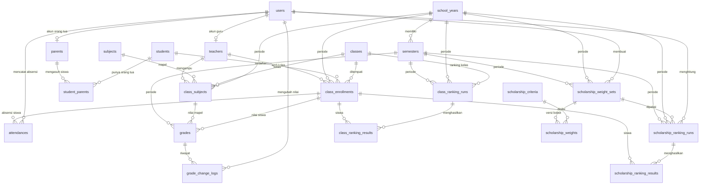

# Skema Database — Dashboard Siswa Sekolah Dasar

Dokumen ini menjelaskan seluruh tabel yang ada dan digunakan pada project **Dashboard Siswa Sekolah Dasar**, termasuk kolom, constraint, indeks, nilai enum, relasi antar tabel, dan aturan bisnis yang dijaga oleh aplikasi.

| Item | Keterangan |
|---|---|
| Project | Laravel 11 · PHP 8.2 · Blade + Tailwind |
| Database pengembangan | SQLite (`database/database.sqlite`) |
| Target produksi | MySQL / PostgreSQL (skema dibuat kompatibel) |
| Sumber kebenaran skema | `database/migrations/` |
| Jumlah tabel | 29 tabel: 21 tabel aplikasi + 8 tabel framework |
| Terakhir diperbarui | 19 November 2026 |

> Catatan tipe data: tipe kolom di bawah ditulis mengikuti *blueprint* Laravel (tipe logis). Pada SQLite, tipe tersebut dipetakan menjadi `INTEGER`, `VARCHAR`, `NUMERIC`, `TEXT`, dan `DATETIME`.

---

## 1. Ringkasan Tabel

### 1.1 Tabel aplikasi

| No | Tabel | Model Eloquent | Kelompok | Fungsi utama |
|---|---|---|---|---|
| 1 | `users` | `User` | Pengguna | Akun login semua role (admin, kepala sekolah, wali kelas, guru mapel, orang tua). |
| 2 | `teachers` | `Teacher` | Pengguna | Data guru; terhubung opsional ke akun `users`. |
| 3 | `parents` | `Guardian` | Pengguna | Data orang tua/wali; terhubung opsional ke akun `users`. |
| 4 | `students` | `Student` | Siswa | Master data siswa. |
| 5 | `student_parents` | `StudentParent` | Siswa | Tabel pivot relasi banyak-ke-banyak siswa ↔ orang tua/wali. |
| 6 | `classes` | `Classroom` | Master akademik | Master kelas (1A–6C) beserta tingkatnya. |
| 7 | `school_years` | `SchoolYear` | Master akademik | Tahun ajaran dan penanda tahun ajaran aktif. |
| 8 | `semesters` | `Semester` | Master akademik | Semester (Ganjil/Genap) di dalam satu tahun ajaran. |
| 9 | `subjects` | `Subject` | Master akademik | Master mata pelajaran beserta KKM. |
| 10 | `class_enrollments` | `ClassEnrollment` | Penempatan | Penempatan siswa di kelas pada suatu tahun ajaran, termasuk wali kelas. |
| 11 | `class_subjects` | `ClassSubject` | Pengajaran | Penugasan guru pengampu untuk satu mapel di satu kelas pada satu tahun ajaran. |
| 12 | `grades` | `Grade` | Nilai | Nilai Tugas, UTS, UAS, nilai akhir, dan status nilai. |
| 13 | `grade_change_logs` | `GradeChangeLog` | Audit | Jejak audit setiap pembuatan/perubahan/penyerahan/penguncian nilai. |
| 14 | `attendances` | `Attendance` | Absensi | Catatan ketidakhadiran harian (sakit, izin, alpa). |
| 15 | `class_ranking_runs` | — (query builder) | Ranking kelas | Header proses perhitungan peringkat kelas per periode. |
| 16 | `class_ranking_results` | — (query builder) | Ranking kelas | Hasil peringkat (snapshot) siswa dalam satu proses ranking kelas. |
| 17 | `scholarship_criteria` | `ScholarshipCriterion` | Beasiswa | Master kriteria beasiswa (C1–C5) beserta arah penilaian. |
| 18 | `scholarship_weight_sets` | `ScholarshipWeightSet` | Beasiswa | Versi kumpulan bobot kriteria per tahun ajaran/semester. |
| 19 | `scholarship_weights` | — (pivot `belongsToMany`) | Beasiswa | Bobot tiap kriteria dalam satu versi bobot. |
| 20 | `scholarship_ranking_runs` | — (query builder) | Beasiswa | Header proses perhitungan ranking beasiswa. |
| 21 | `scholarship_ranking_results` | — (query builder) | Beasiswa | Hasil ranking beasiswa (snapshot) beserta skor preferensi. |

### 1.2 Tabel framework

| Tabel | Fungsi |
|---|---|
| `migrations` | Mencatat migrasi yang sudah dijalankan. |
| `password_reset_tokens` | Token reset password. |
| `sessions` | Sesi login pengguna. |
| `cache` | Penyimpanan cache berbasis database. |
| `cache_locks` | Lock untuk cache. |
| `jobs` | Antrean job queue. |
| `job_batches` | Metadata job batch. |
| `failed_jobs` | Job yang gagal. |

---

## 2. Konvensi Umum

1. **Primary key** setiap tabel aplikasi bernama `id` bertipe `bigint unsigned` auto increment, kecuali tabel pivot `student_parents` yang memakai *composite primary key*.
2. **Foreign key** memakai pola `<entitas>_id` dan otomatis memiliki indeks dari Laravel (`foreignId()->constrained()`).
3. **Timestamp** memakai `created_at` dan `updated_at`. Tabel append-only hanya punya `created_at` (dan kadang `changed_at`), sedangkan `grade_change_logs` tidak memakai keduanya.
4. **Soft delete tidak digunakan.** Penonaktifan data memakai kolom `is_active`, atau status khusus pada tabel transaksi.
5. **Enum disimpan sebagai `varchar`**, bukan tipe enum database, agar portabel antara SQLite, MySQL, dan PostgreSQL. Nilai yang sah dijaga oleh validasi aplikasi (lihat [Bagian 5](#5-kamus-nilai-enum)).
6. **Penamaan tabel mengikuti aturan jamak bahasa Inggris.** Dua pengecualian karena alasan historis/teknis:
   - Tabel `parents` memakai model `Guardian` (kata `Parent` bermasalah secara semantik di PHP).
   - Tabel `classes` memakai model `Classroom` (`Class` adalah *reserved word* PHP).
7. **Data akademik tidak saling menimpa antar periode.** Tahun ajaran dan semester selalu menjadi bagian kunci data nilai, absensi, penempatan, bobot, dan ranking.
8. **Otorisasi bukan di level database.** Pembatasan akses per role dan per siswa dilakukan di lapisan aplikasi (middleware, controller, dan scope), bukan lewat row-level security database.

---

## 3. ERD (Entity Relationship Diagram)

### 3.1 Ringkasan relasi

| Dari | Ke | Kardinalitas | Foreign key | Perilaku hapus |
|---|---|---|---|---|
| `users` | `teachers` | 1 — 0..1 | `teachers.user_id` | `SET NULL` |
| `users` | `parents` | 1 — 0..1 | `parents.user_id` | `SET NULL` |
| `students` | `student_parents` | 1 — N | `student_parents.student_id` | `CASCADE` |
| `parents` | `student_parents` | 1 — N | `student_parents.parent_id` | `CASCADE` |
| `students` | `class_enrollments` | 1 — N | `class_enrollments.student_id` | `NO ACTION` |
| `classes` | `class_enrollments` | 1 — N | `class_enrollments.class_id` | `NO ACTION` |
| `school_years` | `class_enrollments` | 1 — N | `class_enrollments.school_year_id` | `NO ACTION` |
| `teachers` | `class_enrollments` | 1 — N | `class_enrollments.homeroom_teacher_id` | `SET NULL` |
| `school_years` | `semesters` | 1 — N | `semesters.school_year_id` | `NO ACTION` |
| `classes` | `class_subjects` | 1 — N | `class_subjects.class_id` | `NO ACTION` |
| `subjects` | `class_subjects` | 1 — N | `class_subjects.subject_id` | `NO ACTION` |
| `school_years` | `class_subjects` | 1 — N | `class_subjects.school_year_id` | `NO ACTION` |
| `teachers` | `class_subjects` | 1 — N | `class_subjects.teacher_id` | `NO ACTION` |
| `class_enrollments` | `grades` | 1 — N | `grades.enrollment_id` | `NO ACTION` |
| `class_subjects` | `grades` | 1 — N | `grades.class_subject_id` | `NO ACTION` |
| `semesters` | `grades` | 1 — N | `grades.semester_id` | `NO ACTION` |
| `users` | `grades` | 1 — N | `grades.updated_by` | `SET NULL` |
| `grades` | `grade_change_logs` | 1 — N | `grade_change_logs.grade_id` | `NO ACTION` |
| `users` | `grade_change_logs` | 1 — N | `grade_change_logs.changed_by` | `NO ACTION` |
| `class_enrollments` | `attendances` | 1 — N | `attendances.enrollment_id` | `NO ACTION` |
| `users` | `attendances` | 1 — N | `attendances.recorded_by` | `NO ACTION` |
| `classes` | `class_ranking_runs` | 1 — N | `class_ranking_runs.class_id` | `NO ACTION` |
| `school_years` | `class_ranking_runs` | 1 — N | `class_ranking_runs.school_year_id` | `NO ACTION` |
| `semesters` | `class_ranking_runs` | 1 — N | `class_ranking_runs.semester_id` | `NO ACTION` |
| `class_ranking_runs` | `class_ranking_results` | 1 — N | `class_ranking_results.ranking_run_id` | `CASCADE` |
| `class_enrollments` | `class_ranking_results` | 1 — N | `class_ranking_results.enrollment_id` | `NO ACTION` |
| `scholarship_criteria` | `scholarship_weights` | 1 — N | `scholarship_weights.criterion_id` | `NO ACTION` |
| `scholarship_weight_sets` | `scholarship_weights` | 1 — N | `scholarship_weights.weight_set_id` | `CASCADE` |
| `school_years` | `scholarship_weight_sets` | 1 — N | `scholarship_weight_sets.school_year_id` | `NO ACTION` |
| `semesters` | `scholarship_weight_sets` | 1 — N | `scholarship_weight_sets.semester_id` | `NO ACTION` |
| `users` | `scholarship_weight_sets` | 1 — N | `scholarship_weight_sets.created_by` | `NO ACTION` |
| `scholarship_weight_sets` | `scholarship_ranking_runs` | 1 — N | `scholarship_ranking_runs.weight_set_id` | `NO ACTION` |
| `school_years` | `scholarship_ranking_runs` | 1 — N | `scholarship_ranking_runs.school_year_id` | `NO ACTION` |
| `semesters` | `scholarship_ranking_runs` | 1 — N | `scholarship_ranking_runs.semester_id` | `NO ACTION` |
| `users` | `scholarship_ranking_runs` | 1 — N | `scholarship_ranking_runs.calculated_by` | `NO ACTION` |
| `scholarship_ranking_runs` | `scholarship_ranking_results` | 1 — N | `scholarship_ranking_results.ranking_run_id` | `CASCADE` |
| `class_enrollments` | `scholarship_ranking_results` | 1 — N | `scholarship_ranking_results.enrollment_id` | `NO ACTION` |

> `NO ACTION` berarti database menolak penghapusan selama baris anak masih mereferensikan baris induk. Aplikasi juga menambahkan pengecekan sebelum menghapus periode yang sudah dipakai (lihat `SemesterController`).

---

## 4. Detail Tabel

### 4.1 Pengguna dan Autentikasi

#### 4.1.1 `users`

**Fungsi:** menyimpan akun login untuk seluruh role. Satu akun hanya memiliki satu role dan dapat dinonaktifkan tanpa dihapus.

**Model:** `App\Models\User`

| Kolom | Tipe | Null | Default | Constraint | Keterangan |
|---|---|---|---|---|---|
| `id` | bigint unsigned | tidak | — | PK, auto increment | Identifier akun. |
| `name` | varchar(255) | tidak | — | — | Nama tampilan pengguna. |
| `email` | varchar(255) | tidak | — | UNIQUE | Email login. |
| `email_verified_at` | timestamp | ya | `NULL` | — | Waktu verifikasi email (belum dipakai di alur utama). |
| `password` | varchar(255) | tidak | — | — | Hash password (bcrypt). |
| `role` | varchar(30) | tidak | `orang_tua` | — | Role: `admin`, `kepala_sekolah`, `wali_kelas`, `guru_mapel`, `orang_tua`. |
| `is_active` | boolean | tidak | `true` | — | Akun nonaktif tidak boleh login. |
| `remember_token` | varchar(100) | ya | `NULL` | — | Token "remember me". |
| `created_at` | timestamp | ya | `NULL` | — | Waktu dibuat. |
| `updated_at` | timestamp | ya | `NULL` | — | Waktu diperbarui. |

**Relasi database:**

- `teachers.user_id` — akun guru (opsional, `UNIQUE`).
- `parents.user_id` — akun orang tua (opsional, `UNIQUE`).
- `grade_change_logs.changed_by` — riwayat perubahan nilai yang dilakukan akun ini.
- `attendances.recorded_by` — absensi yang dicatat akun ini.
- `scholarship_weight_sets.created_by` — versi bobot beasiswa yang dibuat.
- `scholarship_ranking_runs.calculated_by` — proses ranking beasiswa yang dijalankan.

**Metode Eloquent:** model `User` tidak mendefinisikan relasi balik. Akses dilakukan dari model anak: `Teacher::user`, `Guardian::user`, `GradeChangeLog::changedBy`, `Attendance::recordedBy`, dan `ScholarshipWeightSet::creator`.

**Dipakai oleh:** autentikasi dan otorisasi role (`app/Enums/Role.php`), `UserController`, seluruh controller yang membutuhkan aktor perubahan data.

---

#### 4.1.2 `teachers`

**Fungsi:** master data guru. Akun login bersifat opsional; guru bisa tercatat sebagai data pengampu tanpa akun.

**Model:** `App\Models\Teacher`

| Kolom | Tipe | Null | Default | Constraint | Keterangan |
|---|---|---|---|---|---|
| `id` | bigint unsigned | tidak | — | PK | Identifier guru. |
| `user_id` | bigint unsigned | ya | `NULL` | UNIQUE, FK → `users.id` (`SET NULL`) | Akun login guru; satu akun hanya untuk satu guru. |
| `employee_number` | varchar(30) | ya | `NULL` | UNIQUE | Nomor induk pegawai/NIP. |
| `full_name` | varchar(150) | tidak | — | — | Nama lengkap guru. |
| `created_at` | timestamp | ya | `NULL` | — | Waktu dibuat. |
| `updated_at` | timestamp | ya | `NULL` | — | Waktu diperbarui. |

**Relasi:**

- `user()` — relasi `belongsTo`.
- `homeroomEnrollments()` — relasi `hasMany` lewat `homeroom_teacher_id`; kelas yang menjadi tanggung jawabnya sebagai wali kelas.
- `classSubjects()` — relasi `hasMany`; mapel/kelas yang diampu sebagai guru mapel.

**Dipakai oleh:** `TeacherController`, `HomeroomStudentService`, `TeachingAssignmentService`, `ClassroomScope`.

---

#### 4.1.3 `parents`

**Fungsi:** master data orang tua/wali. Akun login opsional, sehingga data orang tua tetap bisa dicatat tanpa akses aplikasi.

**Model:** `App\Models\Guardian` (nama tabel tetap `parents`).

| Kolom | Tipe | Null | Default | Constraint | Keterangan |
|---|---|---|---|---|---|
| `id` | bigint unsigned | tidak | — | PK | Identifier orang tua/wali. |
| `user_id` | bigint unsigned | ya | `NULL` | UNIQUE, FK → `users.id` (`SET NULL`) | Akun login orang tua; satu akun hanya untuk satu data orang tua. |
| `full_name` | varchar(150) | tidak | — | — | Nama lengkap. |
| `phone` | varchar(30) | ya | `NULL` | — | Nomor telepon/WhatsApp. |
| `income_type` | varchar(20) | ya | `NULL` | — | Jenis input pendapatan: `nominal` (angka pasti) atau `range` (kategori rentang). |
| `income_amount` | decimal(15,2) | ya | `NULL` | — | Pendapatan bulanan dalam rupiah; hanya terisi bila `income_type = nominal`. |
| `income_range` | varchar(30) | ya | `NULL` | — | Kategori rentang bulanan; hanya terisi bila `income_type = range`. Nilai sah: `lt_1jt`, `1_3jt`, `3_5jt`, `gt_5jt`. |
| `created_at` | timestamp | ya | `NULL` | — | Waktu dibuat. |
| `updated_at` | timestamp | ya | `NULL` | — | Waktu diperbarui. |

**Relasi:**

- `user()` — relasi `belongsTo`.
- `students()` — relasi `belongsToMany` lewat `student_parents`, dengan pivot `relationship` dan `created_at`.

**Dipakai oleh:** `StudentController`, `UserController` (akun orang tua), `ChildAttendanceService`, halaman rapor anak, serta input pendapatan untuk kriteria beasiswa C3 (`GuardianIncomeController`, `ChildIncomeController`).

**Catatan pendapatan:** hanya satu nilai yang aktif per orang tua/wali (tanpa riwayat per periode). `income_type` menentukan kolom mana yang dipakai, sehingga `income_amount` dan `income_range` tidak pernah terisi bersamaan. Admin dan wali kelas (khusus siswa di kelas perwaliannya) dapat mengisi, dan akun orang tua dapat mengisi pendapatannya sendiri.

---

### 4.2 Siswa dan Hubungan Orang Tua

#### 4.2.1 `students`

**Fungsi:** master data siswa. Penempatan kelas tidak disimpan di tabel ini, melainkan di `class_enrollments` agar riwayat per tahun ajaran tetap utuh.

**Model:** `App\Models\Student`

| Kolom | Tipe | Null | Default | Constraint | Keterangan |
|---|---|---|---|---|---|
| `id` | bigint unsigned | tidak | — | PK | Identifier siswa. |
| `nis` | varchar(30) | tidak | — | UNIQUE | Nomor Induk Siswa (identitas internal sekolah). |
| `nisn` | varchar(20) | ya | `NULL` | UNIQUE | Nomor Induk Siswa Nasional. |
| `full_name` | varchar(150) | tidak | — | — | Nama lengkap siswa. |
| `birth_date` | date | ya | `NULL` | — | Tanggal lahir. |
| `gender` | varchar(10) | ya | `NULL` | — | `L` (laki-laki) atau `P` (perempuan). |
| `address` | text | ya | `NULL` | — | Alamat tempat tinggal. |
| `is_active` | boolean | tidak | `true` | — | Status keaktifan siswa. |
| `created_at` | timestamp | ya | `NULL` | — | Waktu dibuat. |
| `updated_at` | timestamp | ya | `NULL` | — | Waktu diperbarui. |

**Relasi:**

- `enrollments()` — relasi `hasMany`; riwayat penempatan kelas per tahun ajaran.
- `guardians()` — relasi `belongsToMany` lewat `student_parents`.

**Catatan:** pada SQLite/MySQL, `nisn` yang `NULL` boleh lebih dari satu baris karena nilai `NULL` tidak dianggap duplikat oleh unique index.

---

#### 4.2.2 `student_parents`

**Fungsi:** tabel pivot relasi banyak-ke-banyak antara siswa dan orang tua/wali, sekaligus menyimpan status hubungan.

**Model:** `App\Models\StudentParent`

| Kolom | Tipe | Null | Default | Constraint | Keterangan |
|---|---|---|---|---|---|
| `student_id` | bigint unsigned | tidak | — | PK komposit, FK → `students.id` (`CASCADE`) | Siswa. |
| `parent_id` | bigint unsigned | tidak | — | PK komposit, FK → `parents.id` (`CASCADE`) | Orang tua/wali. |
| `relationship` | varchar(20) | tidak | — | — | `ayah`, `ibu`, atau `wali`. |
| `created_at` | timestamp | ya | `NULL` | — | Waktu relasi dicatat. |

**Constraint & indeks:**

- PRIMARY KEY (`student_id`, `parent_id`).
- INDEX (`parent_id`, `student_id`) untuk pencarian cepat dari sisi orang tua.
- Tidak memiliki `id`, `updated_at`, maupun model timestamps standar.

**Relasi:**

- `student()` — relasi `belongsTo`.
- `guardian()` — relasi `belongsTo` lewat `parent_id`.

**Catatan:** relasi inilah yang menjadi dasar pembatasan akses orang tua: akun `users` → `parents` → `student_parents` → `students`.

---

### 4.3 Master Akademik

#### 4.3.1 `school_years`

**Fungsi:** periode tahun ajaran. Hanya satu tahun ajaran yang seharusnya aktif pada satu waktu.

**Model:** `App\Models\SchoolYear`

| Kolom | Tipe | Null | Default | Constraint | Keterangan |
|---|---|---|---|---|---|
| `id` | bigint unsigned | tidak | — | PK | Identifier tahun ajaran. |
| `name` | varchar(20) | tidak | — | UNIQUE | Contoh: `2026/2027`. |
| `start_date` | date | tidak | — | — | Tanggal mulai. |
| `end_date` | date | tidak | — | — | Tanggal selesai. |
| `is_active` | boolean | tidak | `false` | — | Penanda tahun ajaran aktif. |
| `created_at` | timestamp | ya | `NULL` | — | Waktu dibuat. |
| `updated_at` | timestamp | ya | `NULL` | — | Waktu diperbarui. |

**Relasi:**

- `semesters()`, `enrollments()`, `classSubjects()` — relasi `hasMany`.
- `scopeActive()` — scope untuk tahun ajaran aktif.

**Relasi database tanpa metode Eloquent:** `scholarship_weight_sets`, `scholarship_ranking_runs`, dan `class_ranking_runs`.

**Dipakai oleh:** `AcademicPeriod::schoolYear()`, `ClassroomScope`, seluruh laporan per periode.

---

#### 4.3.2 `semesters`

**Fungsi:** semester di dalam tahun ajaran. Menjadi kunci periode untuk nilai, ranking, dan bobot beasiswa.

**Model:** `App\Models\Semester`

| Kolom | Tipe | Null | Default | Constraint | Keterangan |
|---|---|---|---|---|---|
| `id` | bigint unsigned | tidak | — | PK | Identifier semester. |
| `school_year_id` | bigint unsigned | tidak | — | FK → `school_years.id` | Tahun ajaran induk. |
| `name` | varchar(20) | tidak | — | UNIQUE bersama `school_year_id` | `Ganjil` atau `Genap`. |
| `start_date` | date | tidak | — | — | Tanggal mulai semester. |
| `end_date` | date | tidak | — | — | Tanggal selesai semester. |
| `created_at` | timestamp | ya | `NULL` | — | Waktu dibuat. |
| `updated_at` | timestamp | ya | `NULL` | — | Waktu diperbarui. |

**Constraint & indeks:**

- UNIQUE (`school_year_id`, `name`) — nama semester unik dalam satu tahun ajaran.

**Relasi:**

- `schoolYear()` — relasi `belongsTo`.

**Relasi database tanpa metode Eloquent:** `grades.semester_id`, `scholarship_weight_sets.semester_id`, `scholarship_ranking_runs.semester_id`, dan `class_ranking_runs.semester_id`.

**Dipakai oleh:** `AcademicPeriod::resolveSemester()`, `GradeController`, `GradeEntryService`, `ClassRankingService`, `ScholarshipWeightController`.

---

#### 4.3.3 `classes`

**Fungsi:** master kelas fisik/rombel, misalnya `1A`, `6B`, beserta tingkatnya.

**Model:** `App\Models\Classroom` (nama tabel `classes` karena `Class` reserved word di PHP).

| Kolom | Tipe | Null | Default | Constraint | Keterangan |
|---|---|---|---|---|---|
| `id` | bigint unsigned | tidak | — | PK | Identifier kelas. |
| `name` | varchar(50) | tidak | — | — | Nama kelas, misalnya `4A`. |
| `grade_level` | smallint unsigned | tidak | — | — | Tingkat kelas 1–6. |
| `created_at` | timestamp | ya | `NULL` | — | Waktu dibuat. |
| `updated_at` | timestamp | ya | `NULL` | — | Waktu diperbarui. |

**Relasi:**

- `enrollments()` — relasi `hasMany`.
- `classSubjects()` — relasi `hasMany`.

**Relasi database tanpa metode Eloquent:** `class_ranking_runs.class_id`.

**Catatan:** tidak ada unique constraint pada (`name`, `grade_level`); keunikan nama kelas dijaga di lapisan aplikasi.

---

#### 4.3.4 `subjects`

**Fungsi:** master mata pelajaran beserta KKM (Kriteria Ketuntasan Minimal).

**Model:** `App\Models\Subject`

| Kolom | Tipe | Null | Default | Constraint | Keterangan |
|---|---|---|---|---|---|
| `id` | bigint unsigned | tidak | — | PK | Identifier mapel. |
| `code` | varchar(30) | tidak | — | UNIQUE | Kode mapel, misalnya `MTK`. |
| `name` | varchar(100) | tidak | — | — | Nama mapel. |
| `kkm` | decimal(5,2) | tidak | `75.00` | — | Batas ketuntasan; nilai akhir di bawah KKM dianggap belum tuntas. |
| `is_active` | boolean | tidak | `true` | — | Mapel nonaktif tidak ditawarkan pada penugasan baru. |
| `created_at` | timestamp | ya | `NULL` | — | Waktu dibuat. |
| `updated_at` | timestamp | ya | `NULL` | — | Waktu diperbarui. |

**Relasi:**

- `classSubjects()` — relasi `hasMany`.

**Catatan:** kolom `kkm` ditambahkan melalui migrasi `2026_10_12_000022` setelah ERD awal.

---

### 4.4 Penempatan dan Pengajaran

#### 4.4.1 `class_enrollments`

**Fungsi:** menempatkan siswa pada satu kelas di satu tahun ajaran, sekaligus menyimpan wali kelas untuk penempatan tersebut. Menjadi induk data nilai, absensi, dan ranking.

**Model:** `App\Models\ClassEnrollment`

| Kolom | Tipe | Null | Default | Constraint | Keterangan |
|---|---|---|---|---|---|
| `id` | bigint unsigned | tidak | — | PK | Identifier penempatan. |
| `student_id` | bigint unsigned | tidak | — | FK → `students.id` | Siswa. |
| `class_id` | bigint unsigned | tidak | — | FK → `classes.id` | Kelas. |
| `school_year_id` | bigint unsigned | tidak | — | FK → `school_years.id` | Tahun ajaran. |
| `homeroom_teacher_id` | bigint unsigned | ya | `NULL` | FK → `teachers.id` (`SET NULL`) | Wali kelas untuk penempatan ini. |
| `status` | varchar(20) | tidak | — | — | `aktif`, `pindah`, atau `selesai`. |
| `created_at` | timestamp | ya | `NULL` | — | Waktu dibuat. |
| `updated_at` | timestamp | ya | `NULL` | — | Waktu diperbarui. |

**Constraint & indeks:**

- UNIQUE (`student_id`, `school_year_id`) — satu siswa hanya satu kelas per tahun ajaran.
- INDEX (`class_id`, `school_year_id`, `status`) — daftar siswa aktif per kelas/periode.
- INDEX (`homeroom_teacher_id`, `school_year_id`) — daftar kelas yang diampu wali kelas.

**Relasi:**

- `student()`, `classroom()`, `schoolYear()`, `homeroomTeacher()` — relasi `belongsTo`.
- `grades()` — relasi `hasMany`.

**Relasi database tanpa metode Eloquent:** `attendances.enrollment_id`, `class_ranking_results.enrollment_id`, dan `scholarship_ranking_results.enrollment_id`.

**Catatan desain:** `homeroom_teacher_id` disimpan per baris enrollment (bukan tabel terpisah). Konsekuensinya semua siswa dalam satu kelas-tahun yang sama harus diisi wali kelas yang sama; nilai ini didenormalisasi agar query daftar siswa per wali kelas sederhana.

---

#### 4.4.2 `class_subjects`

**Fungsi:** menugaskan guru pengampu untuk satu mata pelajaran di satu kelas pada satu tahun ajaran.

**Model:** `App\Models\ClassSubject`

| Kolom | Tipe | Null | Default | Constraint | Keterangan |
|---|---|---|---|---|---|
| `id` | bigint unsigned | tidak | — | PK | Identifier penugasan. |
| `class_id` | bigint unsigned | tidak | — | FK → `classes.id` | Kelas. |
| `subject_id` | bigint unsigned | tidak | — | FK → `subjects.id` | Mata pelajaran. |
| `school_year_id` | bigint unsigned | tidak | — | FK → `school_years.id` | Tahun ajaran. |
| `teacher_id` | bigint unsigned | tidak | — | FK → `teachers.id` | Guru pengampu. |
| `created_at` | timestamp | ya | `NULL` | — | Waktu dibuat. |
| `updated_at` | timestamp | ya | `NULL` | — | Waktu diperbarui. |

**Constraint & indeks:**

- UNIQUE (`class_id`, `subject_id`, `school_year_id`) — satu mapel di satu kelas hanya punya satu guru pengampu per tahun ajaran.
- INDEX (`teacher_id`, `school_year_id`) — daftar penugasan milik seorang guru.

**Relasi:**

- `classroom()`, `subject()`, `schoolYear()`, `teacher()` — relasi `belongsTo`.
- `grades()` — relasi `hasMany`.

**Dipakai oleh:** `TeachingAssignmentService`, `GradeEntryService`, `ClassReportService`, `GradeAverageService`.

---

### 4.5 Nilai dan Audit

#### 4.5.1 `grades`

**Fungsi:** menyimpan komponen nilai dan nilai akhir seorang siswa untuk satu mapel pada satu semester, beserta status alur kerja nilainya.

**Model:** `App\Models\Grade`

| Kolom | Tipe | Null | Default | Constraint | Keterangan |
|---|---|---|---|---|---|
| `id` | bigint unsigned | tidak | — | PK | Identifier nilai. |
| `enrollment_id` | bigint unsigned | tidak | — | FK → `class_enrollments.id` | Siswa pada kelas/tahun tertentu. |
| `class_subject_id` | bigint unsigned | tidak | — | FK → `class_subjects.id` | Mapel + guru pengampu. |
| `semester_id` | bigint unsigned | tidak | — | FK → `semesters.id` | Semester penilaian. |
| `assignment_score` | decimal(5,2) | tidak | — | 0–100 (validasi aplikasi) | Nilai Tugas. |
| `uts_score` | decimal(5,2) | tidak | — | 0–100 (validasi aplikasi) | Nilai UTS. |
| `uas_score` | decimal(5,2) | tidak | — | 0–100 (validasi aplikasi) | Nilai UAS. |
| `final_score` | decimal(5,2) | tidak | — | 0–100 (hasil hitung) | Nilai akhir. |
| `status` | varchar(20) | tidak | `draft` | — | `draft`, `diserahkan`, atau `terkunci`. |
| `updated_by` | bigint unsigned | ya | `NULL` | FK → `users.id` (`SET NULL`) | Pengguna terakhir yang mengubah nilai. |
| `created_at` | timestamp | ya | `NULL` | — | Waktu dibuat. |
| `updated_at` | timestamp | ya | `NULL` | — | Waktu diperbarui. |

**Constraint & indeks:**

- UNIQUE (`enrollment_id`, `class_subject_id`, `semester_id`) — satu nilai per siswa per mapel per semester.
- INDEX (`semester_id`, `class_subject_id`) — rekap nilai per mapel per semester.
- INDEX (`semester_id`, `status`) — monitoring status pengisian nilai.

**Aturan nilai:**

- `final_score` = `(0,30 × assignment_score) + (0,30 × uts_score) + (0,40 × uas_score)`, dibulatkan 2 desimal (`Grade::finalScore()`).
- Nilai akhir dibandingkan dengan `subjects.kkm` untuk menentukan ketuntasan (`Grade::isBelowKkm()`).
- Alur status: `draft` → `diserahkan` → `terkunci`. Nilai berstatus `terkunci` tidak dapat diubah (`GradeEntryService::save()`).

**Relasi:**

- `enrollment()`, `classSubject()`, `semester()` — relasi `belongsTo`.
- `changeLogs()` — relasi `hasMany` ke `GradeChangeLog`.

**Catatan:** kolom `status` dan indeks (`semester_id`, `status`) ditambahkan melalui migrasi `2026_10_12_000022` setelah ERD awal.

---

#### 4.5.2 `grade_change_logs`

**Fungsi:** jejak audit *append-only* untuk setiap pembuatan, perubahan, penyerahan, dan penguncian nilai. Mencatat aktor, waktu, nilai lama/baru, dan alasan.

**Model:** `App\Models\GradeChangeLog`

| Kolom | Tipe | Null | Default | Constraint | Keterangan |
|---|---|---|---|---|---|
| `id` | bigint unsigned | tidak | — | PK | Identifier log. |
| `grade_id` | bigint unsigned | tidak | — | FK → `grades.id` | Nilai yang diubah. |
| `changed_by` | bigint unsigned | tidak | — | FK → `users.id` | Pengguna yang melakukan perubahan. |
| `action` | varchar(20) | tidak | — | — | `created`, `updated`, `submitted`, `locked`. |
| `old_values` | text | ya | `NULL` | — | Snapshot nilai sebelum perubahan dalam bentuk JSON string. |
| `new_values` | text | ya | `NULL` | — | Snapshot nilai sesudah perubahan dalam bentuk JSON string. |
| `changed_at` | datetime | tidak | — | — | Waktu perubahan. |
| `reason` | text | ya | `NULL` | — | Alasan/keterangan perubahan. |

**Constraint & indeks:**

- INDEX (`grade_id`, `changed_at`) — riwayat terurut per nilai.
- INDEX (`changed_by`, `changed_at`) — audit aktivitas per pengguna.
- Tidak memakai `created_at`/`updated_at`; waktu dicatat di `changed_at`.

**Isi snapshot JSON:** `assignment_score`, `uts_score`, `uas_score`, `final_score`, `status`.

**Relasi:**

- `grade()` — relasi `belongsTo`.
- `changedBy()` — relasi `belongsTo` ke `User` lewat `changed_by`.

**Dipakai oleh:** `GradeEntryService`, `GradeAuditController`.

---

### 4.6 Absensi

#### 4.6.1 `attendances`

**Fungsi:** mencatat **ketidakhadiran** harian siswa. Kehadiran tidak disimpan sebagai baris.

**Model:** `App\Models\Attendance`

| Kolom | Tipe | Null | Default | Constraint | Keterangan |
|---|---|---|---|---|---|
| `id` | bigint unsigned | tidak | — | PK | Identifier absensi. |
| `enrollment_id` | bigint unsigned | tidak | — | FK → `class_enrollments.id` | Siswa pada kelas/tahun tertentu. |
| `attendance_date` | date | tidak | — | UNIQUE bersama `enrollment_id` | Tanggal absensi. |
| `status` | varchar(10) | tidak | — | — | `sakit`, `izin`, atau `alpa`. |
| `recorded_by` | bigint unsigned | tidak | — | FK → `users.id` | Pengguna yang mencatat. |
| `notes` | text | ya | `NULL` | — | Keterangan tambahan. |
| `created_at` | timestamp | ya | `NULL` | — | Waktu dibuat. |
| `updated_at` | timestamp | ya | `NULL` | — | Waktu diperbarui. |

**Constraint & indeks:**

- UNIQUE (`enrollment_id`, `attendance_date`) — satu catatan per siswa per hari.
- INDEX (`attendance_date`, `status`) — rekap harian per status.

**Aturan bisnis:**

- Hanya `sakit`, `izin`, dan `alpa` yang disimpan.
- Pilihan `hadir` pada form **menghapus** catatan absensi siswa pada tanggal tersebut, bukan menyimpan baris baru (`AttendanceController::store()`).
- Persentase kehadiran dihitung dari jumlah hari efektif dikurangi total ketidakhadiran.

**Relasi:**

- `enrollment()` — relasi `belongsTo`.
- `recordedBy()` — relasi `belongsTo` ke `User` lewat `recorded_by`.

**Dipakai oleh:** `AttendanceController`, `AttendanceReportService`, `ChildAttendanceService`, `DashboardService`.

---

### 4.7 Ranking Kelas

#### 4.7.1 `class_ranking_runs`

**Fungsi:** header satu proses peringkat untuk kombinasi kelas + tahun ajaran + semester. Berfungsi sebagai wadah hasil dan status publikasi.

| Kolom | Tipe | Null | Default | Constraint | Keterangan |
|---|---|---|---|---|---|
| `id` | bigint unsigned | tidak | — | PK | Identifier proses ranking. |
| `school_year_id` | bigint unsigned | tidak | — | FK → `school_years.id` | Tahun ajaran. |
| `semester_id` | bigint unsigned | tidak | — | FK → `semesters.id` | Semester. |
| `class_id` | bigint unsigned | tidak | — | FK → `classes.id` | Kelas yang diperingkat. |
| `calculated_at` | datetime | tidak | — | — | Waktu perhitungan terakhir. |
| `status` | varchar(20) | tidak | — | — | `draft` atau `published`. |
| `created_at` | timestamp | ya | `NULL` | — | Waktu dibuat. |

**Constraint & indeks:**

- INDEX (`class_id`, `school_year_id`, `semester_id`) — pencarian run per kelas/periode.
- Tidak memiliki `updated_at`.

**Relasi database (tanpa model Eloquent):**

- `class_id` → `classes.id`, `school_year_id` → `school_years.id`, `semester_id` → `semesters.id`.
- Satu run memiliki banyak `class_ranking_results`.

**Aturan:** `ClassRankingService` memakai ulang satu baris run untuk kombinasi kelas + tahun + semester yang sama. Setiap perhitungan ulang mengubah status kembali menjadi `draft` dan menghapus hasil lama.

---

#### 4.7.2 `class_ranking_results`

**Fungsi:** snapshot hasil peringkat siswa dalam satu proses ranking kelas.

| Kolom | Tipe | Null | Default | Constraint | Keterangan |
|---|---|---|---|---|---|
| `id` | bigint unsigned | tidak | — | PK | Identifier hasil. |
| `ranking_run_id` | bigint unsigned | tidak | — | FK → `class_ranking_runs.id` (`CASCADE`) | Proses ranking induk. |
| `enrollment_id` | bigint unsigned | tidak | — | FK → `class_enrollments.id` | Siswa yang diperingkat. |
| `rank` | int unsigned | tidak | — | — | Peringkat, mulai dari 1. |
| `average_score` | decimal(5,2) | tidak | — | — | Rata-rata `grades.final_score` seluruh mapel pada semester tersebut. |
| `created_at` | timestamp | ya | `NULL` | — | Waktu hasil dibuat. |

**Constraint & indeks:**

- UNIQUE (`ranking_run_id`, `enrollment_id`) — satu hasil per siswa per run.
- INDEX (`ranking_run_id`, `rank`) — pembacaan hasil terurut.

**Relasi database (tanpa model Eloquent):**

- `ranking_run_id` → `class_ranking_runs.id`, `enrollment_id` → `class_enrollments.id`.

**Aturan:** siswa tanpa nilai tidak dihasilkan. Nilai rata-rata yang sama diurutkan stabil berdasarkan `enrollment_id`.

---

### 4.8 Beasiswa

#### 4.8.1 `scholarship_criteria`

**Fungsi:** master kriteria penilaian beasiswa. Data awal (seeder): C1 Nilai Akademik, C2 Persentase Kehadiran, C3 Penghasilan Orang Tua, C4 Jumlah Tanggungan Keluarga, C5 Prestasi Non-Akademik.

**Catatan C3:** nilai kriteria diambil dari `parents.income_amount` (bila `income_type = nominal`) atau kategori `parents.income_range` (bila `income_type = range`), lalu disalin ke `scholarship_ranking_results.criteria_snapshot` saat ranking dihitung.

**Model:** `App\Models\ScholarshipCriterion`

| Kolom | Tipe | Null | Default | Constraint | Keterangan |
|---|---|---|---|---|---|
| `id` | bigint unsigned | tidak | — | PK | Identifier kriteria. |
| `code` | varchar(30) | tidak | — | UNIQUE | Kode kriteria, misalnya `C1`. |
| `name` | varchar(100) | tidak | — | — | Nama kriteria. |
| `attribute_type` | varchar(20) | tidak | — | — | `numeric` atau `ordinal`. |
| `direction` | varchar(10) | tidak | — | — | `benefit` (makin besar makin baik) atau `cost` (makin kecil makin baik). |
| `description` | text | ya | `NULL` | — | Penjelasan cara pengukuran. |
| `is_active` | boolean | tidak | `true` | — | Hanya kriteria aktif yang wajib diberi bobot. |
| `created_at` | timestamp | ya | `NULL` | — | Waktu dibuat. |
| `updated_at` | timestamp | ya | `NULL` | — | Waktu diperbarui. |

**Relasi database:**

- `scholarship_weights.criterion_id` → `scholarship_criteria.id`.
- Relasi banyak-ke-banyak ke versi bobot tersedia lewat `ScholarshipWeightSet::criteria()` dengan pivot `scholarship_weights`.

**Metode Eloquent:** model ini belum mendefinisikan metode relasi.

---

#### 4.8.2 `scholarship_weight_sets`

**Fungsi:** versi kumpulan bobot kriteria untuk satu tahun ajaran dan semester. Versi lama disimpan agar hasil ranking lama tetap dapat direproduksi.

**Model:** `App\Models\ScholarshipWeightSet`

| Kolom | Tipe | Null | Default | Constraint | Keterangan |
|---|---|---|---|---|---|
| `id` | bigint unsigned | tidak | — | PK | Identifier versi bobot. |
| `school_year_id` | bigint unsigned | tidak | — | FK → `school_years.id` | Tahun ajaran. |
| `semester_id` | bigint unsigned | tidak | — | FK → `semesters.id` | Semester. |
| `version_name` | varchar(50) | tidak | — | UNIQUE aplikasi per semester | Nama versi, misalnya `Bobot v1`. |
| `is_locked` | boolean | tidak | `false` | — | Versi terkunci tidak dapat diubah/dihapus. |
| `created_by` | bigint unsigned | tidak | — | FK → `users.id` | Pembuat versi. |
| `created_at` | timestamp | ya | `NULL` | — | Waktu dibuat. |
| `updated_at` | timestamp | ya | `NULL` | — | Waktu diperbarui. |

**Constraint & indeks:**

- INDEX (`school_year_id`, `semester_id`) — daftar versi per periode.
- Keunikan `version_name` per `semester_id` dijaga oleh validasi `ScholarshipWeightSetRequest`.

**Relasi:**

- `schoolYear()`, `semester()`, `creator()` — relasi `belongsTo`.
- `criteria()` — relasi `belongsToMany` ke `ScholarshipCriterion` lewat `scholarship_weights` (pivot `weight`).
- `totalWeight()` dan `rankingRunsCount()` — helper agregasi berbasis query, bukan relasi.

**Relasi database tanpa metode Eloquent:** `scholarship_weights` dan `scholarship_ranking_runs`.

**Aturan:** total bobot seluruh kriteria aktif harus tepat 100% (disimpan sebagai pecahan, misalnya 35% → `0.350000`). Kunci hanya dapat dibuka selama versi belum pernah dipakai pada proses ranking.

---

#### 4.8.3 `scholarship_weights`

**Fungsi:** tabel pivot yang menyimpan bobot tiap kriteria pada satu versi bobot.

| Kolom | Tipe | Null | Default | Constraint | Keterangan |
|---|---|---|---|---|---|
| `id` | bigint unsigned | tidak | — | PK | Identifier bobot. |
| `weight_set_id` | bigint unsigned | tidak | — | FK → `scholarship_weight_sets.id` (`CASCADE`) | Versi bobot induk. |
| `criterion_id` | bigint unsigned | tidak | — | FK → `scholarship_criteria.id` | Kriteria. |
| `weight` | decimal(8,6) | tidak | — | — | Bobot dalam bentuk pecahan (0–1), presisi 6 desimal. |
| `created_at` | timestamp | ya | `NULL` | — | Waktu dibuat. |
| `updated_at` | timestamp | ya | `NULL` | — | Waktu diperbarui. |

**Constraint & indeks:**

- UNIQUE (`weight_set_id`, `criterion_id`) — satu bobot per kriteria per versi.

**Relasi database (tanpa model Eloquent):**

- `weight_set_id` → `scholarship_weight_sets.id` (`CASCADE`), `criterion_id` → `scholarship_criteria.id`.
- Diakses melalui relasi `ScholarshipWeightSet::criteria()` dan `sync()` pada Eloquent.

---

#### 4.8.4 `scholarship_ranking_runs`

**Fungsi:** header proses perhitungan ranking beasiswa untuk satu periode dengan satu versi bobot.

| Kolom | Tipe | Null | Default | Constraint | Keterangan |
|---|---|---|---|---|---|
| `id` | bigint unsigned | tidak | — | PK | Identifier proses ranking. |
| `school_year_id` | bigint unsigned | tidak | — | FK → `school_years.id` | Tahun ajaran. |
| `semester_id` | bigint unsigned | tidak | — | FK → `semesters.id` | Semester. |
| `weight_set_id` | bigint unsigned | tidak | — | FK → `scholarship_weight_sets.id` | Versi bobot yang dipakai. |
| `calculated_at` | datetime | tidak | — | — | Waktu perhitungan. |
| `status` | varchar(20) | tidak | — | — | `draft`, `published`, atau `superseded`. |
| `calculated_by` | bigint unsigned | tidak | — | FK → `users.id` | Pengguna yang menjalankan perhitungan. |
| `created_at` | timestamp | ya | `NULL` | — | Waktu dibuat. |

**Constraint & indeks:**

- INDEX (`school_year_id`, `semester_id`, `status`) dengan nama `sch_ranking_runs_period_status_index`. Nama dipendekkan karena nama otomatis Laravel melampaui batas 64 karakter MySQL.
- Tidak memiliki `updated_at`.

**Relasi database (tanpa model Eloquent):**

- `school_year_id` → `school_years.id`, `semester_id` → `semesters.id`, `weight_set_id` → `scholarship_weight_sets.id`, `calculated_by` → `users.id`.
- Satu run memiliki banyak `scholarship_ranking_results`.

**Catatan implementasi:** tabel ini menyimpan riwayat hasil. Dashboard hanya membaca run berstatus `published`, dan status `superseded` menandai hasil lama yang sudah digantikan versi bobot/periode berikutnya. Mesin perhitungan ranking beasiswa belum tersedia sebagai service pada kode saat ini; data contoh diisi melalui seeder.

---

#### 4.8.5 `scholarship_ranking_results`

**Fungsi:** snapshot hasil ranking beasiswa per siswa, termasuk skor preferensi dan salinan nilai kriteria yang dipakai saat perhitungan.

| Kolom | Tipe | Null | Default | Constraint | Keterangan |
|---|---|---|---|---|---|
| `id` | bigint unsigned | tidak | — | PK | Identifier hasil. |
| `ranking_run_id` | bigint unsigned | tidak | — | FK → `scholarship_ranking_runs.id` (`CASCADE`) | Proses ranking induk. |
| `enrollment_id` | bigint unsigned | tidak | — | FK → `class_enrollments.id` | Siswa yang dinilai. |
| `rank` | int unsigned | tidak | — | — | Peringkat, mulai dari 1. |
| `preference_score` | decimal(12,10) | tidak | — | — | Skor preferensi hasil normalisasi/pembobotan kriteria. |
| `criteria_snapshot` | text | tidak | — | — | Salinan nilai tiap kriteria dalam bentuk JSON string. |
| `created_at` | timestamp | ya | `NULL` | — | Waktu hasil dibuat. |

**Constraint & indeks:**

- UNIQUE (`ranking_run_id`, `enrollment_id`) — satu hasil per siswa per proses.
- INDEX (`ranking_run_id`, `rank`) — pembacaan hasil terurut.

**Relasi database (tanpa model Eloquent):**

- `ranking_run_id` → `scholarship_ranking_runs.id`, `enrollment_id` → `class_enrollments.id`.

**Alasan snapshot:** perubahan bobot atau data siswa di kemudian hari tidak boleh mengubah hasil ranking historis.

---

### 4.9 Tabel Framework

Tabel berikut dibuat oleh Laravel dan tidak menyimpan data domain sekolah.

| Tabel | Kolom penting | Keterangan |
|---|---|---|
| `migrations` | `id`, `migration`, `batch` | Riwayat migrasi yang dijalankan. |
| `password_reset_tokens` | `email` (PK), `token`, `created_at` | Token reset password. |
| `sessions` | `id` (PK), `user_id` (index), `ip_address`, `user_agent`, `payload`, `last_activity` (index) | Sesi login; `user_id` tidak memiliki FK constraint. |
| `cache` | `key` (PK), `value`, `expiration` (index) | Cache berbasis database. |
| `cache_locks` | `key` (PK), `owner`, `expiration` (index) | Lock cache. |
| `jobs` | `id`, `queue` (index), `payload`, `attempts`, `reserved_at`, `available_at`, `created_at` | Antrean job. |
| `job_batches` | `id` (PK), `name`, `total_jobs`, `pending_jobs`, `failed_jobs`, `failed_job_ids`, `options`, `cancelled_at`, `created_at`, `finished_at` | Metadata batch job. |
| `failed_jobs` | `id`, `uuid` (UNIQUE), `connection`, `queue`, `payload`, `exception`, `failed_at` | Job gagal. |

---

## 5. Kamus Nilai Enum

| Tabel.kolom | Nilai sah | Arti |
|---|---|---|
| `users.role` | `admin` | Administrator sistem dan master data. |
| | `kepala_sekolah` | Melihat dashboard dan laporan sekolah. |
| | `wali_kelas` | Mengelola nilai dan absensi kelas yang menjadi tanggung jawabnya. |
| | `guru_mapel` | Menginput nilai mapel yang diampu. |
| | `orang_tua` | Melihat data anaknya secara read-only. |
| `students.gender` | `L` | Laki-laki. |
| | `P` | Perempuan. |
| `class_enrollments.status` | `aktif` | Siswa aktif di kelas tersebut. |
| | `pindah` | Siswa pindah sekolah/kelas. |
| | `selesai` | Masa penempatan selesai (misalnya tahun ajaran lampau). |
| `student_parents.relationship` | `ayah` | Ayah kandung. |
| | `ibu` | Ibu kandung. |
| | `wali` | Wali non-orang tua kandung. |
| `grades.status` | `draft` | Nilai masih dapat diubah pengampu. |
| | `diserahkan` | Nilai diserahkan ke wali kelas untuk direkap. |
| | `terkunci` | Nilai final dan tidak dapat diubah. |
| `grade_change_logs.action` | `created` | Nilai baru dibuat. |
| | `updated` | Komponen nilai diubah. |
| | `submitted` | Status berubah menjadi `diserahkan`. |
| | `locked` | Status berubah menjadi `terkunci`. |
| `attendances.status` | `sakit` | Tidak hadir karena sakit. |
| | `izin` | Tidak hadir dengan izin. |
| | `alpa` | Tidak hadir tanpa keterangan. |
| `scholarship_criteria.attribute_type` | `numeric` | Nilai berupa angka kontinu. |
| | `ordinal` | Nilai berupa skala/tingkatan (misalnya 1–5). |
| `scholarship_criteria.direction` | `benefit` | Semakin besar semakin baik. |
| | `cost` | Semakin kecil semakin baik. |
| `class_ranking_runs.status` | `draft` | Hasil belum diterbitkan. |
| | `published` | Hasil sudah diterbitkan dan ditampilkan. |
| `scholarship_ranking_runs.status` | `draft` | Hasil belum diterbitkan. |
| | `published` | Hasil sudah diterbitkan dan dibaca dashboard. |
| | `superseded` | Hasil lama yang sudah digantikan proses berikutnya. |

---

## 6. Aturan Bisnis dan Integritas Data

1. **Satu siswa, satu kelas, satu tahun ajaran.**
   UNIQUE (`student_id`, `school_year_id`) pada `class_enrollments` menjaga riwayat penempatan tidak tumpang tindih, sekaligus memungkinkan siswa naik kelas pada tahun berikutnya tanpa menimpa data lama.

2. **Wali kelas melekat pada penempatan.**
   `class_enrollments.homeroom_teacher_id` menyimpan wali kelas untuk siswa tersebut. Aplikasi memakai kolom ini untuk membatasi daftar siswa yang boleh diakses wali kelas.

3. **Guru pengampu per kelas-mapel-tahun.**
   UNIQUE (`class_id`, `subject_id`, `school_year_id`) pada `class_subjects` memastikan tidak ada dua guru berbeda untuk mapel yang sama di kelas dan tahun yang sama.

4. **Satu nilai per siswa per mapel per semester.**
   UNIQUE (`enrollment_id`, `class_subject_id`, `semester_id`) pada `grades`. Nilai akhir dihitung otomatis 30% Tugas + 30% UTS + 40% UAS.

5. **Nilai memiliki alur status dan tidak dapat diubah setelah terkunci.**
   `draft` → `diserahkan` → `terkunci`. Penulisan nilai memeriksa status dan melewati baris yang sudah `terkunci`. Setiap perubahan menghasilkan baris baru di `grade_change_logs` berisi snapshot JSON.

6. **Ketuntasan diukur terhadap KKM mapel.**
   `subjects.kkm` (default 75) dibandingkan dengan `grades.final_score`. Nilai di bawah KKM dipakai pada rekap, dashboard, dan laporan.

7. **Absensi hanya mencatat ketidakhadiran.**
   Hanya `sakit`, `izin`, dan `alpa` yang disimpan. Status `hadir` pada form menghapus catatan lama pada tanggal tersebut. Persentase kehadiran dihitung dari hari efektif dikurangi jumlah ketidakhadiran.

8. **Data akademik dipisahkan per periode.**
   Nilai, absensi, penempatan, bobot, dan ranking selalu terikat pada `school_year_id`/`semester_id`. `SemesterController` menolak penghapusan semester yang masih dipakai pada `grades`, `scholarship_weight_sets`, `scholarship_ranking_runs`, atau `class_ranking_runs`.

9. **Ranking adalah snapshot yang dapat dihitung ulang.**
   Perhitungan ulang memakai kembali baris `class_ranking_runs` yang sama, mengubah status ke `draft`, menghapus hasil lama, lalu menulis ulang `class_ranking_results`. Publikasi hanya mengubah status run, bukan datanya.

10. **Bobot beasiswa berversi dan dapat dikunci.**
    Setiap versi bobot harus berjumlah tepat 100% untuk seluruh kriteria aktif dan disimpan sebagai pecahan (35% → `0.350000`). Versi yang sudah dipakai pada `scholarship_ranking_runs` tidak dapat dihapus atau dibuka kuncinya.

11. **Hasil ranking beasiswa menyimpan salinan kriteria.**
    `criteria_snapshot` dan `preference_score` disimpan agar hasil historis tetap valid meskipun data siswa atau bobot berubah.

12. **Akses orang tua dibatasi oleh relasi, bukan hanya role.**
    Rantai `users` → `parents` → `student_parents` → `students` menjadi dasar penentuan siswa yang boleh dilihat. Pemeriksaan tetap dilakukan di controller/service agar manipulasi URL tidak dapat membuka data siswa lain.

13. **Penghapusan data induk ditahan.**
    Sebagian besar FK memakai `NO ACTION`, sehingga data master yang sudah dipakai transaksi tidak bisa dihapus. Pengecualian yang aman: akun pengguna (`SET NULL` pada profil guru/orang tua), wali kelas (`SET NULL`), serta hasil ranking (`CASCADE` dari run).

14. **Pendapatan orang tua/wali hanya punya satu nilai aktif.**
    Disimpan pada `parents` (`income_type`, `income_amount`, `income_range`) tanpa riwayat per periode. `income_type` wajib menentukan salah satu: `nominal` (isi `income_amount`) atau `range` (isi `income_range`), sehingga keduanya tidak pernah terisi bersamaan. Admin bebas mengubah semua data, wali kelas hanya untuk siswa di kelas perwaliannya, dan akun orang tua hanya untuk profilnya sendiri (relasi `users` → `parents`). Nilai ini menjadi sumber kriteria C3 pada ranking beasiswa.

---

## 7. Daftar Indeks dan Constraint Penting

### 7.1 Unique constraint

| Tabel | Kolom | Tujuan |
|---|---|---|
| `users` | `email` | Satu email satu akun. |
| `teachers` | `user_id` | Satu akun satu profil guru. |
| `teachers` | `employee_number` | NIP unik. |
| `parents` | `user_id` | Satu akun satu profil orang tua. |
| `students` | `nis` | NIS unik. |
| `students` | `nisn` | NISN unik (boleh banyak `NULL`). |
| `school_years` | `name` | Nama tahun ajaran unik. |
| `semesters` | `school_year_id`, `name` | Ganjil/Genap unik per tahun ajaran. |
| `subjects` | `code` | Kode mapel unik. |
| `class_enrollments` | `student_id`, `school_year_id` | Satu kelas per siswa per tahun. |
| `class_subjects` | `class_id`, `subject_id`, `school_year_id` | Satu guru pengampu per mapel per kelas per tahun. |
| `grades` | `enrollment_id`, `class_subject_id`, `semester_id` | Satu nilai per siswa per mapel per semester. |
| `attendances` | `enrollment_id`, `attendance_date` | Satu absensi per siswa per hari. |
| `scholarship_criteria` | `code` | Kode kriteria unik. |
| `scholarship_weights` | `weight_set_id`, `criterion_id` | Satu bobot per kriteria per versi. |
| `class_ranking_results` | `ranking_run_id`, `enrollment_id` | Satu hasil per siswa per run. |
| `scholarship_ranking_results` | `ranking_run_id`, `enrollment_id` | Satu hasil per siswa per run. |

### 7.2 Indeks non-unik

| Tabel | Kolom | Tujuan |
|---|---|---|
| `student_parents` | `parent_id`, `student_id` | Pencarian siswa dari sisi orang tua. |
| `class_enrollments` | `class_id`, `school_year_id`, `status` | Daftar siswa aktif per kelas/periode. |
| `class_enrollments` | `homeroom_teacher_id`, `school_year_id` | Daftar siswa binaan wali kelas. |
| `class_subjects` | `teacher_id`, `school_year_id` | Daftar penugasan guru. |
| `grades` | `semester_id`, `class_subject_id` | Rekap nilai per mapel per semester. |
| `grades` | `semester_id`, `status` | Monitoring status pengisian nilai. |
| `grade_change_logs` | `grade_id`, `changed_at` | Riwayat perubahan per nilai. |
| `grade_change_logs` | `changed_by`, `changed_at` | Audit aktivitas pengguna. |
| `attendances` | `attendance_date`, `status` | Rekap harian per status. |
| `scholarship_weight_sets` | `school_year_id`, `semester_id` | Daftar versi bobot per periode. |
| `scholarship_ranking_runs` | `school_year_id`, `semester_id`, `status` | Pencarian run terbit per periode (nama indeks: `sch_ranking_runs_period_status_index`). |
| `class_ranking_runs` | `class_id`, `school_year_id`, `semester_id` | Pencarian run per kelas/periode. |
| `class_ranking_results` | `ranking_run_id`, `rank` | Pembacaan hasil terurut. |
| `scholarship_ranking_results` | `ranking_run_id`, `rank` | Pembacaan hasil terurut. |

---

## 8. Referensi Migrasi

| File migrasi | Tabel/perubahan |
|---|---|
| `0001_01_01_000000_create_users_table.php` | `users`, `password_reset_tokens`, `sessions` |
| `0001_01_01_000001_create_cache_table.php` | `cache`, `cache_locks` |
| `0001_01_01_000002_create_jobs_table.php` | `jobs`, `job_batches`, `failed_jobs` |
| `2026_10_12_000001_add_role_and_is_active_to_users_table.php` | Kolom `users.role`, `users.is_active` |
| `2026_10_12_000002_create_students_table.php` | `students` |
| `2026_10_12_000003_create_teachers_table.php` | `teachers` |
| `2026_10_12_000004_create_parents_table.php` | `parents` |
| `2026_10_12_000005_create_student_parents_table.php` | `student_parents` |
| `2026_10_12_000006_create_classes_table.php` | `classes` |
| `2026_10_12_000007_create_school_years_table.php` | `school_years` |
| `2026_10_12_000008_create_semesters_table.php` | `semesters` |
| `2026_10_12_000009_create_subjects_table.php` | `subjects` |
| `2026_10_12_000010_create_class_enrollments_table.php` | `class_enrollments` |
| `2026_10_12_000011_create_class_subjects_table.php` | `class_subjects` |
| `2026_10_12_000012_create_grades_table.php` | `grades` |
| `2026_10_12_000013_create_grade_change_logs_table.php` | `grade_change_logs` |
| `2026_10_12_000014_create_attendances_table.php` | `attendances` |
| `2026_10_12_000015_create_scholarship_criteria_table.php` | `scholarship_criteria` |
| `2026_10_12_000016_create_scholarship_weight_sets_table.php` | `scholarship_weight_sets` |
| `2026_10_12_000017_create_scholarship_weights_table.php` | `scholarship_weights` |
| `2026_10_12_000018_create_scholarship_ranking_runs_table.php` | `scholarship_ranking_runs` |
| `2026_10_12_000019_create_scholarship_ranking_results_table.php` | `scholarship_ranking_results` |
| `2026_10_12_000020_create_class_ranking_runs_table.php` | `class_ranking_runs` |
| `2026_10_12_000021_create_class_ranking_results_table.php` | `class_ranking_results` |
| `2026_10_12_000022_add_kkm_to_subjects_and_status_to_grades_tables.php` | Kolom `subjects.kkm`, `grades.status`, indeks `grades(semester_id, status)` |
| `2026_11_19_000001_add_income_to_parents_table.php` | Kolom `parents.income_type`, `parents.income_amount`, `parents.income_range` |

---

## 9. Cara Menelusuri Relasi dari Kode

| Kebutuhan | Jalur relasi |
|---|---|
| Kelas seorang siswa pada tahun ajaran tertentu | `Student::enrollments()->where('school_year_id', $id)` → `ClassEnrollment::classroom` |
| Wali kelas seorang siswa | `ClassEnrollment::homeroomTeacher` |
| Guru pengampu suatu mapel di kelas | `ClassSubject::where(class_id, subject_id, school_year_id)` → `teacher` |
| Nilai siswa per semester | `ClassEnrollment::grades()->where('semester_id', $id)` → `Grade::classSubject`, `Grade::semester` |
| Riwayat perubahan satu nilai | `Grade::changeLogs()->latest('changed_at')` → `GradeChangeLog::changedBy` |
| Absensi siswa per bulan | `Attendance::where('enrollment_id', $id)` atau `AttendanceReportService::recap()` |
| Orang tua dari siswa | `Student::guardians` (pivot `student_parents`) |
| Siswa dari akun orang tua | `Guardian::where('user_id', $id)` → `students` |
| Pendapatan orang tua/wali | `Guardian::income_type`, `Guardian::income_amount`, `Guardian::income_range` (label: `Guardian::incomeLabel()`) |
| Ranking kelas terbit | Tabel `class_ranking_runs` status `published` → `class_ranking_results` → `class_enrollments` → `students` (query builder) |
| Ranking beasiswa terbit | Tabel `scholarship_ranking_runs` status `published` → `scholarship_ranking_results` → `class_enrollments` → `students` (query builder) |
| Bobot yang dipakai suatu hasil ranking | `scholarship_ranking_runs.weight_set_id` → `ScholarshipWeightSet::criteria` (pivot `weight`) |

---

Dokumen ini mengikuti kondisi kode pada 19 November 2026. Bila ada migrasi baru, perbarui bagian ringkasan tabel, detail kolom, ERD, dan daftar indeks pada dokumen ini.
